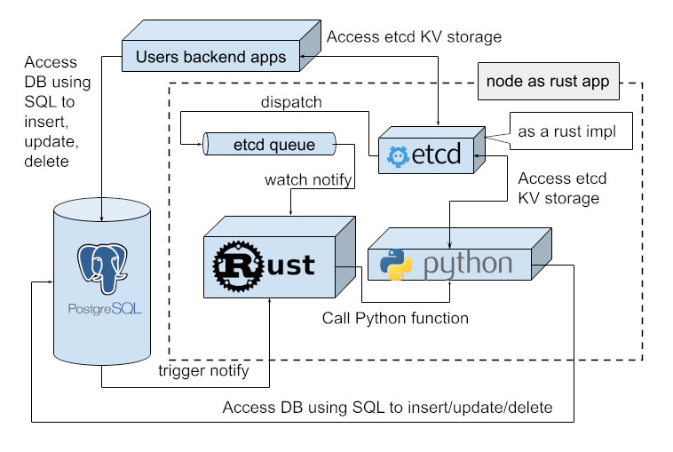

# [Articles](https://vkrinitsyn.github.io)


## YT Cluster
[link](/yt#yt-cluster)
**Every node accepts writes. On the Postgres you already run.**
Vanilla PostgreSQL plus an extension and a server process - no forked engine, no proxy in front, no managed-cloud lock-in - [dbinvent.com](https://dbinvent.com/)

Released - tested and ready: [](https://github.com/DBinvent/yt-cluster-tests/blob/main/nightly/results.yaml)

**News, 2026-10-25 - under Jepsen,** the industry standard for data consistency testing, very picky and very aggressive by design: 51 findings, every one fixed and retested,
none critical from the first run on - [the findings](https://claude.ai/artifact/Dtu2vx8WUyNm19J8NBjRFH) by severity &middot; [the news](https://www.dbinvent.com/news/yt-cluster-under-jepsen)
- **No data transfer** - your database becomes a cluster node where it already sits; nothing is dumped, copied or migrated
- **No vendor lock** - remove the extension and you are back to a single plain PostgreSQL, with your data in place
- **No code change** - same SQL, same drivers, same extensions; a plain `COMMIT` is a cluster commit, with no PgBouncer and no explicit completion call
- **No dedicated master** - nothing to promote, so nothing to fail over; a RAFT-based coordinator arbitrates and assigns workers, and never becomes the bottleneck
- **Writes spread across every node** - transaction boundaries are derived at runtime (virtual dynamic partitioning), so disjoint writes land on different nodes
- **Synchronization as configuration** - per-table rules decide what is redundant, what is local, and how many nodes a commit waits for: `half`, `nodes>=N`, or asynchronous
- **Resiliency in three layers** - two-phase commit on the way in; self-healing after the fact, which re-reads, votes on and repairs a divergent copy; and a row, table or node nobody can vouch for is *blocked* rather than guessed
- **Software-defined topology** (AZ, zones, tiers) - replication scope and row placement are rules, rewritten online with no redeploy or downtime
- **MPP analytics** - Apache DataFusion planned against the declared topology, ClickHouse for columnar workloads; neither needs a copy of the data
- **Asking in plain language** - `yt_llm('...')` on a local model returns PostgreSQL SQL, ClickHouse SQL or a DataFusion script, chosen by where the data lives; the model sees the catalog, never a row ([how it works](/yt/llm.md))
- **A node is one container** - [`dbinvent/yt`](https://hub.docker.com/r/dbinvent/yt): PostgreSQL 18 with the extension and ytserv, set up from its environment; three writable nodes with Docker Compose in [Running in Docker](https://www.dbinvent.com/cluster/guide/docker)
- **One package, not a suite** - server functions ([RPPD](/rppd#rppd---rust-python-postgres-discovery)), etcd key-value, streaming and queue ([etcd](/etcd#etcd)) ship with the cluster, and it applies schema migrations with [Schema Guard](/sg1#schema-guard)'s library - the `sge` tool itself is an open-source package of its own

From 30 years of personal IT experience into **[30 pillars of the solution](/yt/pillars.md)** - what it solves, one line each.

Measured, not asserted: **1.7x the throughput (171%)** of PostgreSQL synchronous replication on a write-only load and **1.6x (162%)** on an 80/20 read/write mix, at equal replication scope. Full synchronous two-phase commit across every node costs more - it is there for the tables that need it, not the default.
[What replication actually costs](https://dbinvent.github.io/yt-cluster-performance.html) &middot; [Where Rows Live](https://dbinvent.github.io/where-rows-live.html) &middot; [CAP](/cap.md) &middot; [Asking in plain language](/yt/llm.md) &middot; [All about YT Cluster](/yt/)


## Schema Guard
[link](/sg1#schema-guard) &middot; [dbinvent.com/sge](https://www.dbinvent.com/sge/)
Open-source schema migration for PostgreSQL - MIT licensed and free for any use, commercial included: [DBinvent/sge](https://github.com/DBinvent/sge).
- **A Flyway replacement with no JVM** - its files run as they are: `V1_2__init.sql` versioned scripts and `R__view.sql` repeatables
- **Declarative and imperative, mixed** - a whole schema in one YAML file, turned into SQL for you, alongside plain SQL scripts
- **History in the target database** - every environment knows which versions it applied and with which checksum, a `select` away (`sge_history`)
- **One binary, `sge`** - `apt install schema-guard` (the same repository as YT Cluster), the image [`dbinvent/sge`](https://hub.docker.com/r/dbinvent/sge) (`sge` and `psql`, about 12 MB), a static binary for any Linux, or `cargo install schema_guard`
- **A Rust library too** - [`schema_guard`](https://crates.io/crates/schema_guard) runs migrations from your own code; it is built on [`schema_guard_tokio`](https://crates.io/crates/schema_guard_tokio) ([source](https://github.com/vkrinitsyn/schema_guard)), the declarative YAML schema library, which embeds a schema in Rust code and needs no history table
- **Cluster-ready** - YT Cluster applies schema with its library, each migration ordered against ordinary writes on every node

## RPPD Rust-Python-Postgres-Discovery
Now with etcd queueing:



[link](/rppd#rppd---rust-python-postgres-discovery) 
Rust-Python-Postgres-Discovery.
Serverless platform for run Python code with Postgres:
- Postgres extension with a trigger to notify backend service about a insert or update or delete event
- Rust based opensource project with languages support (i18n)


## Concurrent document modification
[link](https://medium.com/@v.krinitsyn/concurrent-document-modification-ea1b6e628e2d)
When two or more users intend to modify the same JSON document in same row, they will face a delay or data corruption, but actually it’s possible to perform with a patching model.


## ETCD 
[link](/etcd#etcd)
Etcd server PoC for messaging queue   
- etcd API v3 compatible client using protobuf
- Lightweight [queue](https://github.com/vkrinitsyn/etcd/blob/main/queue.md) with order and delivery guarantee
- Rust based opensource project
 
##  Decentralized Skills Exchange and Mutual Credit Network
[link](/qw/abstract.md#decentralized-skills-exchange-and-mutual-credit-network)
A search-aware framework for discovering and appreciating developers across open source,
startup, and IT projects - without requiring money to change hands.
Participants find each other through verified skill reputation, commit to work via
signed contracts, and compensate contributions with personal credit tokens denominated
in time.

## Tools

### Marg - MetaArgs for console rust apps
[link](https://github.com/vkrinitsyn/marg) 
Fewer application configuration to connection to database and store everything else in DB.
- Available as cargo dependency in Rust:
  ``` marg = "0.4.0" ```

### Shims
[link](https://github.com/vkrinitsyn/shim/) - Calculate sliding average
Percentile and bucket size configuration support for histogram calculation.
- Available as cargo dependency in Rust:
  ``` shims = "0.1.0" ```


---
Other links [DBinvent](https://DBinvent.github.io)
